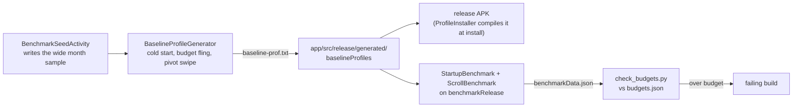

# Benchmarks

Principle I of the constitution sets budgets for how the app feels: the budget on screen within 1 s
of a cold start, and scrolling and pivot swipes with no dropped frames. This module measures them
and records the baseline profile that keeps them fast.

## What runs

| Test | Measures | Budget (CI emulator) |
|---|---|---|
| `StartupBenchmark.coldStart` | `timeToFullDisplayMs`: cold start until the open month is read and drawn (`ReportBudgetDrawn`), without and with the profile | `budgets.json` |
| `ScrollBenchmark.budgetScroll` | `frameOverrunMs`: flings the budget list down and back | `budgets.json` |
| `ScrollBenchmark.pivotSwipe` | `frameOverrunMs`: swipes home through all five items | `budgets.json` |

`frameOverrunMs` above 0 is a frame that missed its deadline. The benchmarks run against
`benchmarkRelease`, a copy of release that adds only the seed entry point (`app/src/benchmark`), so the
start lands on a real month instead of onboarding. Release and debug never carry it.

## Running

- **CI**: `.github/workflows/benchmark.yml` runs on every change to app code or the build, on a Pixel 6
  emulator (API 34). It records the profile, measures, and fails when a result is over `budgets.json`.
  The recorded profile is uploaded as the `baseline-profile` artifact.
- **Record the profile**: `./gradlew :app:generateBaselineProfile` (the emulator), or add
  `-PbenchmarkOnDevice` to use the phone plugged in. Commit the changed
  `app/src/release/generated/baselineProfiles/baseline-prof.txt`.
- **Measure on a phone**: `./gradlew :benchmark:connectedBenchmarkReleaseAndroidTest
  -Pandroid.testInstrumentationRunnerArguments.androidx.benchmark.enabledRules=Macrobenchmark`, then
  `python3 benchmark/check_budgets.py`. On a Pixel 6a class phone the startup median should be under
  1000 ms and `frameOverrunMs` P90 at or under 0.

## The budgets

The emulator draws in software and has no real phone's clocks, so its numbers are slower than a
Pixel 6a's. `budgets.json` holds limits set from the emulator's measured results with headroom, so CI
catches a change that makes startup or scrolling clearly worse. The first runs measured a cold start
of 2.1 to 2.4 s with the profile (2.3 to 2.4 s without), and frame overruns at P90 of about 144 ms
(budget scroll) and 104 ms (pivot swipe): the software GPU misses nearly every frame, so these frame
limits only catch large regressions. The constitution's own numbers (1 s,
no dropped frames) are checked on a real phone with the command above.
