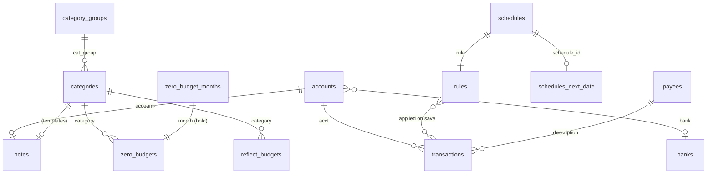
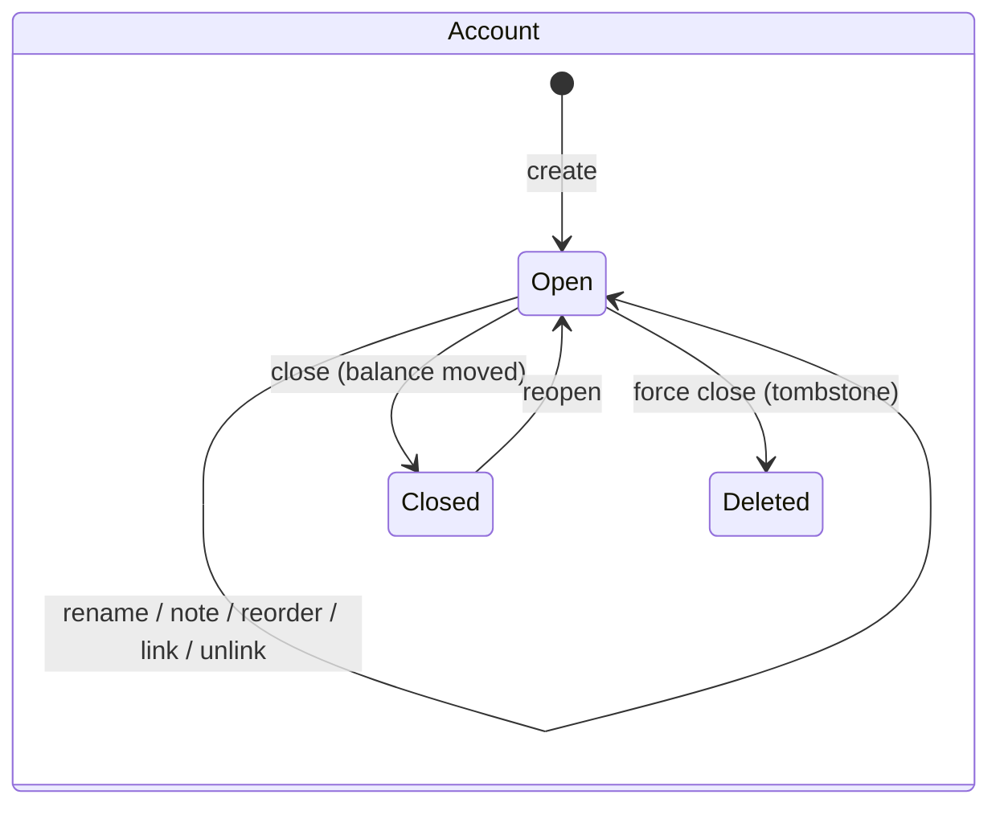

# Data Model: Actual Parity

All persistent state is in the open budget's `db.sqlite`, in Actual 26.8.1's tables and columns. Every write goes through `SyncSchema.recordLocal` (the funnel) so it becomes a pending sync message. The only new phone-side state is the in-memory undo stack and one `phone.json` toggle.

## Synced datasets (new or widened)

| Dataset | Columns written by this spec | Used by |
|---|---|---|
| `accounts` | `name`, `offbudget`, `closed`, `sort_order`, `tombstone`, `account_id`, `bank`, `account_sync_source`, `balance_current`, `balance_available`, `balance_limit`, `last_sync` | US2, US6 |
| `notes` | `note` (row id = category id, or `account-<account id>`) | US2, US5 |
| `banks` | `bank_id`, `name`, `tombstone` | US6 |
| `rules` | `stage`, `conditions_op`, `conditions`, `actions`, `tombstone` | US3, learning |
| `schedules` | `name`, `rule`, `active`, `completed`, `posts_transaction`, `tombstone` | US3 |
| `schedules_next_date` | `schedule_id`, `local_next_date`, `local_next_date_ts`, `base_next_date`, `base_next_date_ts`, `tombstone` | US3 |
| `categories` | `goal_def` (in addition to existing) | US5 |
| `zero_budgets` / `reflect_budgets` | `goal`, `long_goal` (in addition to `month`, `category`, `amount`, `carryover`) | US1, US5 |
| `preferences` | `learn-categories`, `flags.goalTemplatesEnabled` | US3, US5 |

`ActualSchema` adds `notes` and `banks` with `CREATE TABLE IF NOT EXISTS`, and the extra columns with guarded `ALTER TABLE` (the same pattern already used for `accounts.account_id`).

## To-budget breakdown (computed, not stored)

| Part | Source in the envelope loop | Sign |
|---|---|---|
| Income this month | `incomeSum` | + |
| Carried in | `fromLast` = last month's to-budget + last month's held | + |
| Overspent last month | `lastOver` (≤ 0, skips categories with rollover) | + (already negative) |
| Budgeted | `budgetedSum` | − |
| Held for next month | `buffered` (manual if non-zero, else auto) | − |
| **To budget** | sum of the above | = header figure |

## Month fill

| Field | Rules |
|---|---|
| kind | `copyLast`, `average3`, `zero`, `templatesApply`, `templatesOverwrite` |
| month | The open month. |
| needsConfirm | True when any target category this month is non-zero, and always for `zero` and `templatesOverwrite`. |
| targets | Visible categories (not hidden, group not hidden). Envelope: expense only for copy/average. Tracking: expense and income. |
| result | `Applied(changedCount)`, `NothingToCopy`, `Cancelled`, `Invalid(categoryNames)` (templates). |

## Auto-hold

| Field | Rules |
|---|---|
| category | Income category, envelope file only. |
| on | `carryover = 1` on months m … m+12. |
| off this month | `carryover = 0` on month m only. |
| off entirely | `carryover = 0` on months m … m+12. |
| precedence | `zero_budget_months.buffered` ≠ 0 overrides auto for that month. |

## Account

| Field | Rules |
|---|---|
| name | Non-blank. |
| offbudget | Chosen at create. Not changed by this spec. |
| starting balance | Non-zero creates a Starting Balance transaction dated today. |
| note | `notes` row `account-<id>`. Survives restart. |
| sort_order | Midpoint between neighbours after reorder. |
| closed | 0 / 1. Closed hidden unless `phone.json` `showClosedAccounts` is true. |
| bank link | `account_id`, `bank`, `account_sync_source` all set, or all blank. |

Close request: `{accountId, transferAccountId?, categoryId?, forced}`. `transferAccountId` required when balance ≠ 0 and not forced. `categoryId` required when on-budget → off-budget. `forced` requires its own confirm.

## Schedule (editor view)

| Field | Stored as |
|---|---|
| name | `schedules.name` (optional, unique when set). |
| account | rule condition `acct is <id>` |
| payee | rule condition `description is <payee id>` |
| amount | rule condition `amount` with `is`, `isapprox`, or `isbetween {num1,num2}` |
| category | rule action `set category` (optional) |
| repeat | rule condition `date`: plain date (one-time) or recur config `{frequency, interval, start, endMode, endOccurrences?, endDate?, patterns?, skipWeekend?, weekendSolveMode?}` |
| next date | `schedules_next_date.local_next_date` |
| auto-post | `schedules.posts_transaction` |
| kept fields | `patterns`, `skipWeekend`, `weekendSolveMode` preserved unchanged when the phone does not edit them. |

## Rule (editor view)

| Field | Rules |
|---|---|
| stage | `pre`, `null` (default), `post`. |
| conditionsOp | `and` / `or`. |
| conditions | Typed rows for payee, account, category, amount, date, notes; any other entry kept as raw JSON and marked "kept from the file". |
| actions | Typed rows for set payee/category/notes/amount/date/cleared and prepend/append notes; any other entry kept raw. |
| enabled | Not in `disabledRules` preference. |

## Report

| Report | Inputs | Output rows |
|---|---|---|
| Cash flow | range (start month, end month) | per month: income, expenses, net; totals |
| Net worth | range, include off-budget | per month end: on-budget, off-budget, total |
| Spending | range, group by (category / group / payee) | name, amount; sorted largest first; total |

## Template line

| Field | Rules |
|---|---|
| category | The note's category. |
| priority | From `#template-N`; `#template` = default priority; `#goal` has no priority. |
| kind | `simple`, `upTo`, `by`, `schedule`, `percentage`, `average`, `remainder`, `goal`. |
| params | Amount, limit, target month, repeat, schedule name, `full`, percent, source, `previous`, months, weight. |
| error | Parse error text; the category is named in the check result. |

## Undo step (memory only)

| Field | Rules |
|---|---|
| label | Short description shown with undo ("assign groceries", "close Visa"). |
| budgetId | The open budget. Step discarded on switch. |
| cells | Ordered `(dataset, row, column, oldValue, newValue)`. `oldValue` null means the row did not exist (undo writes `tombstone = 1`). |
| stack | Newest first, max 100, cleared on process death. |

Undo outcome: `Undone` or `Conflict(cells)`. A conflict writes nothing and appears in spec 004's conflict list.

## State transitions

## Validation

- Transfer to to-budget larger than available: refused, nothing written.
- Account with blank name: refused.
- Close with balance and no destination: refused.
- Schedule with no account or no amount: refused.
- Rule with no condition or no action: refused.
- Template check with any invalid line: nothing budgeted.
- Undo with an empty stack: the control is absent.
