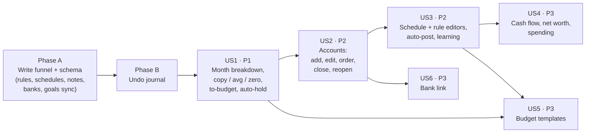
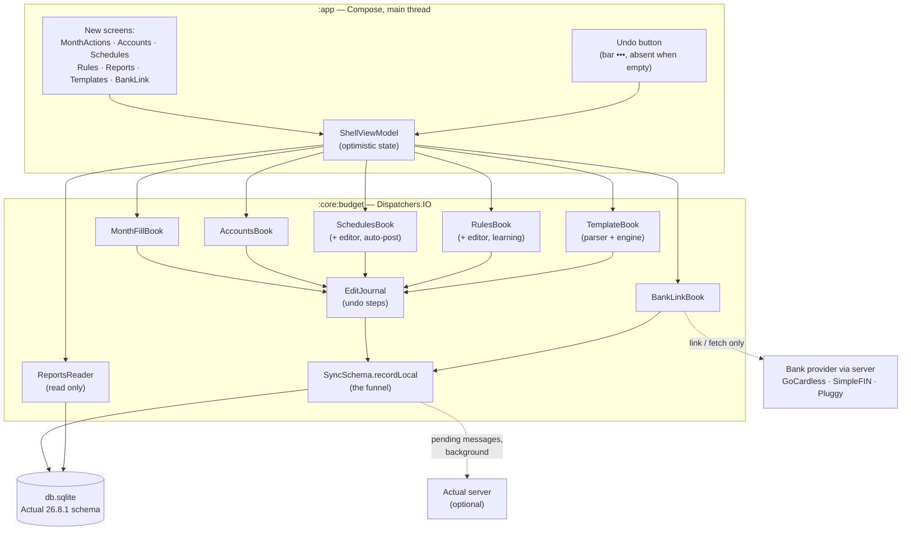
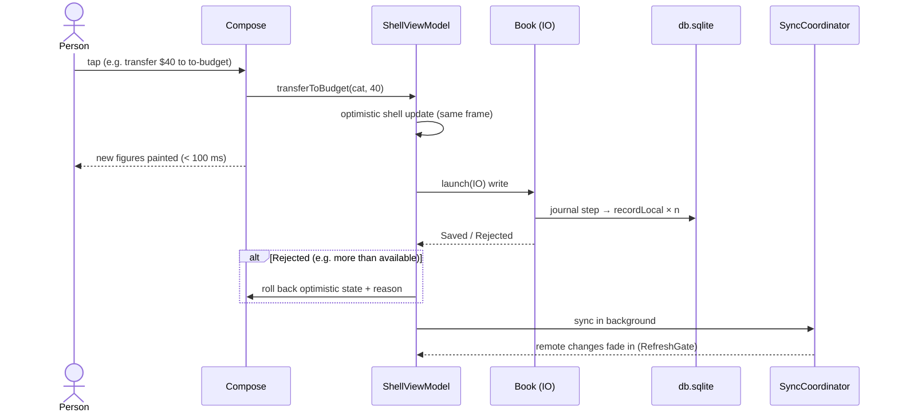
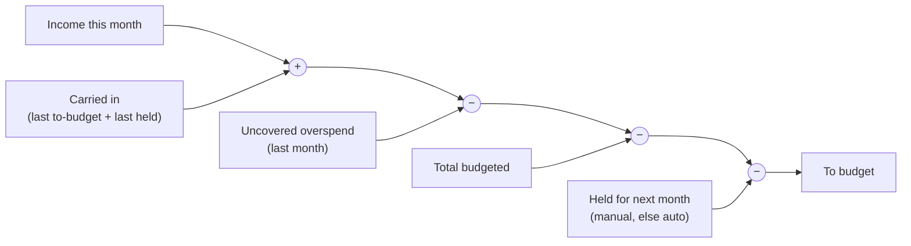
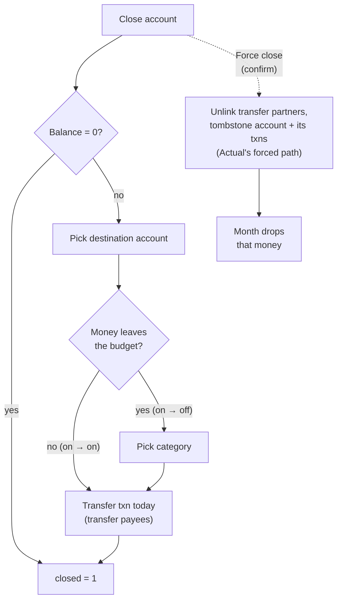
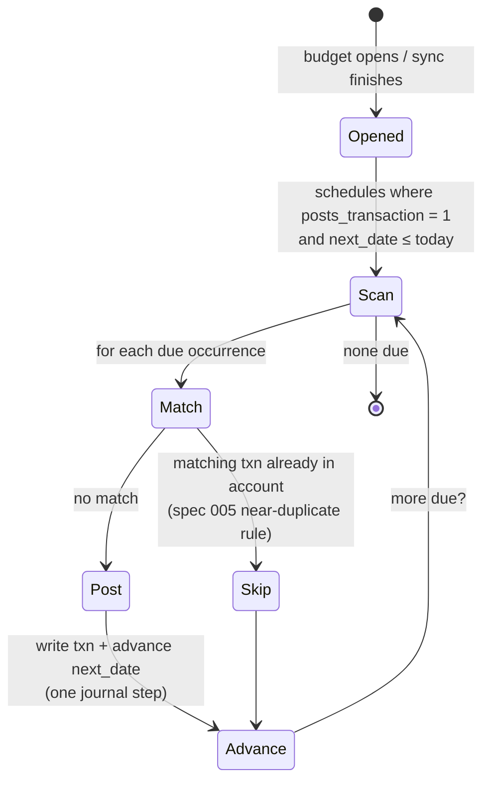
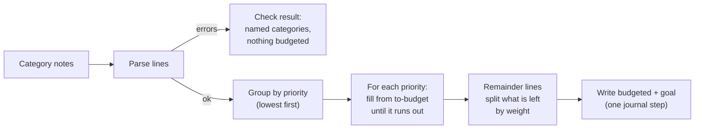
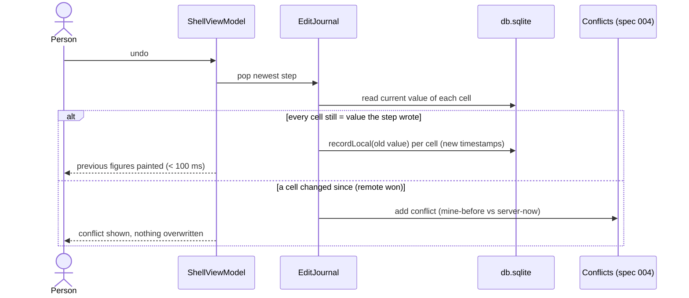

# Implementation Plan: Actual Parity

**Branch**: `010-actual-parity` | **Date**: 2026-10-13 | **Spec**: [spec.md](spec.md)

**Input**: Feature specification from `/specs/010-actual-parity/spec.md`

## Summary

Spec 010 closes the gap between the phone and desktop Actual for everything a person can do to a budget file that specs 001–009 left out: explaining and filling the month, managing accounts, editing schedules and rules, three reports, budget templates, bank links, and undo. Every one of these is a write to (or a read of) the on-phone `db.sqlite` in the same tables and columns `@actual-app/core` 26.8.1 uses, so desktop Actual shows the same numbers after a sync.

The technical spine is one change: **every write goes through the sync write funnel** (`SyncSchema.recordLocal`). Today rules and schedules are inserted with plain SQL and never reach the server. This plan widens the funnel's dataset/column map to cover `rules`, `schedules`, `schedules_next_date`, `notes`, `banks`, the bank columns on `accounts`, and the goal columns on budgets, then builds each feature as a small book in `:core:budget` that only writes through it. Because every write passes through one place, undo is a journal on that funnel, and offline-first comes for free: nothing in a book talks to the network except the bank-link transport.

Delivery is ordered by the spec's priorities, with the funnel first because everything else depends on it:



## Technical Context

**Language/Version**: Kotlin 2.2, Java 17 bytecode, Android minSdk 26, compileSdk 36

**Primary Dependencies**: Jetpack Compose BOM (foundation, animation, UI; no Material), Metro components in `:core:design`, `BudgetLibrary` / `SyncCoordinator` / `SyncSchema` / `RuleEngine` / `Schedules` / `BankSync` / `ActualMonthMath` in `:core:budget`, kotlinx.serialization JSON for rule and schedule payloads, AndroidX Browser Custom Tabs (already added by spec 009) for the GoCardless consent page. No new third-party library. The template grammar is a hand-written parser, not a parser generator.

**Storage**: The open budget's `db.sqlite`. New or widened synced datasets: `rules`, `schedules`, `schedules_next_date`, `notes`, `banks`, `accounts` (+ `account_id`, `bank`, `account_sync_source`, `balance_current`, `balance_available`, `balance_limit`, `last_sync`), `categories` (+ `goal_def`), `zero_budgets` / `reflect_budgets` (+ `goal`, `long_goal`). Preferences gain `learn-categories` and `flags.goalTemplatesEnabled` (Actual's own ids). The undo journal is in memory only. Bank secrets go to the Actual server's `/secret` endpoint and never into `db.sqlite` or `phone.json`. No new Gradle module.

**Testing**: JUnit on the JVM for every book against fixture sqlite files produced by desktop Actual 26.8.1 (golden files committed under `core/budget/src/test/resources/parity/`): month breakdown and fills, transfer to to-budget, auto-hold across 13 months, account create/close/force-close/reopen, schedule recurrence and auto-post idempotence, rule editor round-trips (unknown ops preserved), learning on/off, the three reports, every template kind, undo and undo-conflict. Sync tests for each new dataset against the spec 004 localhost harness. Robolectric Compose tests for every new screen and confirm gate. Roborazzi light and dark screenshots. Fluidity checks extend the spec 001 budgets to a 100-rule save and an undo.

**Target Platform**: Android phone (minSdk 26)

**Project Type**: Mobile app

**Performance Goals**: Undo, transfer to to-budget, and close account paint before the finger lifts (under 100 ms, SC-002, SC-007). Auto-post finishes within 1 s of opening the app (SC-003). A save with 100 rules stays within 50 ms of a save with none (SC-004): rules are parsed once per budget open and cached, invalidated only by a rule write. Reports for a year of a 10k-transaction file render in under 500 ms on `Dispatchers.IO` with content-shaped placeholders until then.

**Constraints**: Offline-first: everything except bank linking and fetching finishes with the network off (FR-016). Month fills, set-to-zero, template overwrite, and force close write nothing until confirmed. The file's budget method is never changed (FR-017); tracking files use `reflect_budgets` and Actual's tracking rules. Desktop parity is measured, not assumed: "matches Actual" means the same fixture file gives the same rows after the same action in desktop Actual 26.8.1. Out of scope per FR-018: custom dashboards, Sankey, Monte Carlo, crossover, server hosting and user admin.

**Scale/Scope**: One open budget. 6 user stories, 18 FRs. Roughly 8 new core books, 9 new screens, 7 contracts. Fixture budgets up to 10k transactions, 100 rules, 50 schedules.

## Constitution Check

*GATE: Must pass before Phase 0 research. Re-check after Phase 1 design.*

| Principle | Gate | Result |
|---|---|---|
| I. Fluid First | Every month action, account edit, and undo updates `OpenMonthStore` from the local write in the same frame as the tap; sync runs after, off the draw thread. Reports and template checks run on `Dispatchers.IO` behind content-shaped placeholders. Rules cached per open so 100 rules do not slow a save. No full-screen spinner anywhere, including bank sign-in (Custom Tab). | Pass |
| II. Metro 2 | New screens (breakdown, month actions menu, account edit, close account, schedule editor, rule editor, reports pivot, template check, bank link, undo) use existing Metro components, pivots where they need tabs, the spec 008 bar and `•••` menu, light and dark. Report bars are flat accent fills, no gradients. | Pass |
| III. The Same Budget as Actual | Every write uses Actual's tables, columns, and preference ids and travels through the sync funnel, fixing today's gap where rules and schedules did not sync. Envelope vs tracking is read, never written. Each behavior is pinned to a desktop-Actual golden fixture. | Pass |
| IV. One Budget at a Time | All books act on the open budget only. Undo is scoped to the open budget and cleared on switch. | Pass |
| V. Test What the Person Can See | JVM tests per book, sync tests per new dataset, screenshots light and dark per new screen, fluidity budgets for the rule-heavy save and undo. | Pass |
| VI. Phone First, Nothing Extra | No new module. **Goal-template editing and reports are listed as out of scope "until the daily loop is fluid".** See Complexity Tracking. | Justified exception |

Post-design re-check: the same gates hold. The funnel change makes Principle III stronger, not weaker. The one exception is VI, justified below and already called out in the spec's Assumptions.

## Architecture

### One write funnel, many books



- Books never call the network except `BankLinkBook`.
- `EditJournal.step { … }` wraps one person-level action. Inside it, `recordLocal` captures each cell's old value before writing. The step is pushed onto the session's undo stack when the block finishes.
- `ReportsReader` only reads, so it is not journaled.

### How a tap stays under 100 ms



## Feature Designs

Each story has a contract in [contracts/](contracts/) and decisions in [research.md](research.md). Highlights:

### US1 · Fill and explain the month (P1)

`ActualMonthMath.DetailedFigures` gains a `breakdown` with the five parts the envelope sheet already computes in its loop (`incomeSum`, `fromLast`, `lastOver`, `budgetedSum`, `buffered`). The breakdown screen reads those, so they add up by construction. `MonthFillBook` ports Actual's `copyPreviousMonth`, `set3MonthAvg`, `setZero`, and the category → to-budget transfer, and `setCategoryCarryover` for income auto-hold over this month and the next 12. Contract: [month-actions.md](contracts/month-actions.md).



### US2 · Accounts (P2)

`AccountsBook` ports `account/create` (with the Starting Balance transaction and payee), rename, notes (`notes` row `account-<id>`), reorder (`sort_order` midpoint), close, force close, and reopen. Contract: [accounts.md](contracts/accounts.md).



### US3 · Schedules and rules (P2)

Schedules get a full editor (account, payee, amount with `is` / `isapprox` / `isbetween`, category, repeat, next date, end, auto-post). Recurrence configs the phone does not edit (patterns such as "last Friday", `skipWeekend`) are preserved and still evaluated. Auto-post runs once per budget open and after each sync, using the same near-duplicate match spec 005 already has. Rules get an editor for the six condition fields and six action fields in all three stages; any condition, op, or action the editor does not know is rendered read-only as "kept from the file" and written back byte-for-byte. Learning reads and writes `learn-categories` and ports `updateCategoryRules`. Contract: [schedules-rules.md](contracts/schedules-rules.md).



### US4 · Reports (P3)

`ReportsReader` computes cash flow, net worth by month, and spending by category / group / payee from living transactions only, with the same transfer and off-budget rules desktop Actual's report queries use. A reports pivot hosts the three, with a shared range picker (this month, last 3, last 6, last 12, year to date, custom). Contract: [reports.md](contracts/reports.md).

### US5 · Budget templates (P3)

`TemplateBook` = a parser for Actual's `#template` / `#goal` lines in category notes + an engine that ports `goaltemplates` 26.8.1 (priorities, fixed, `up to`, `by` with `repeat`, schedule, percentage, `average N months`, `remainder` with weights, `#goal`). Gate: `flags.experimental` (spec 009) AND `flags.goalTemplatesEnabled`. Check, apply (zero only), and overwrite (confirmed). Results also write `goal` / `long_goal` so desktop shows the same goal colors. Contract: [templates.md](contracts/templates.md).



### US6 · Bank link and undo (P3)

`BankLinkBook` talks to the active Actual server's provider endpoints (GoCardless, SimpleFIN, Pluggy.ai), writes `banks` and the account's link columns through the funnel, and unlinks by clearing them. A SimpleFIN setup token is posted to the server's `/secret` store and never kept on the phone. Contract: [bank-link.md](contracts/bank-link.md).

Undo is an in-memory stack of journal steps for the open budget in this app session. Undoing re-writes each cell's old value as a **new** pending message, so it syncs like any edit. Before it writes, it checks that every cell still holds the value the step wrote; if a remote change replaced one, the step becomes a visible conflict (spec 004's conflict list) instead of overwriting. Contract: [undo.md](contracts/undo.md).



## Project Structure

### Documentation (this feature)

```text
specs/010-actual-parity/
├── spec.md
├── plan.md              # this file
├── research.md          # Phase 0
├── data-model.md        # Phase 1
├── quickstart.md        # Phase 1
├── contracts/           # Phase 1
│   ├── sync-datasets.md
│   ├── month-actions.md
│   ├── accounts.md
│   ├── schedules-rules.md
│   ├── reports.md
│   ├── templates.md
│   ├── bank-link.md
│   └── undo.md
├── checklists/
│   └── requirements.md
└── tasks.md             # /speckit-tasks, not this command
```

### Source Code (repository root)

```text
core/budget/src/main/kotlin/app/duenorth/budget/core/
  ActualSchema.kt          # notes, banks tables; goal_def, goal, long_goal, bank columns (idempotent ALTERs)
  SyncSchema.kt            # widen dataset/column map + ensureRow for new datasets; journal hook in recordLocal
  EditJournal.kt           # NEW: undo steps, capture old values, conflict check
  ActualMonthMath.kt       # expose MonthBreakdown from envelope loop; tracking equivalents
  MonthFill.kt             # NEW: copy, 3-month avg, zero, transfer to to-budget, auto-hold
  Accounts.kt              # NEW: create, rename, note, reorder, close, force close, reopen
  Schedules.kt             # editor writes via funnel; auto-post; recurrence config builder
  RuleEngine.kt            # writes via funnel; editor model; unknown-op passthrough; rule cache; learning
  Reports.kt               # NEW: cash flow, net worth by month, spending
  Templates.kt             # NEW: template parser + engine
  BankSync.kt              # + BankLinkBook: provider status, accounts, link, unlink, secret
  ActualTransport.kt       # provider endpoints (gocardless/*, simplefin/*, pluggyai/*, secret)
  BudgetLibrary.kt         # thin entry points for the above
  SyncCoordinator.kt       # run auto-post after open and after sync
core/budget/src/test/kotlin/app/duenorth/budget/core/
  parity/                  # NEW: golden-fixture tests per story
core/budget/src/test/resources/parity/   # NEW: desktop-Actual fixture budgets + expected rows
app/src/main/kotlin/app/duenorth/budget/
  MonthActionScreens.kt    # NEW: breakdown, fill confirm, transfer to to-budget, auto-hold
  AccountScreens.kt        # NEW: add, edit, reorder, close, closed list
  ScheduleScreens.kt       # + schedule editor
  RuleScreens.kt           # NEW: rule list + editor, learning switch
  ReportScreens.kt         # NEW: reports pivot + range picker
  TemplateScreens.kt       # NEW: check / apply / overwrite
  BankLinkScreens.kt       # NEW: provider pick, account match, unlink
  ScreenBar.kt             # new bar/menu ids incl. undo
  ShellViewModel.kt        # routes + optimistic updates + undo stack owner
  SettingsScreens.kt       # learning switch; templates switch under experimental
```

**Structure Decision**: No new Gradle module. Every behavior that must match Actual lives in `:core:budget` and is tested on the JVM against desktop fixtures. `:app` only adds screens and routes. `ShellViewModel.kt` is already 2,100 lines, so new route handlers go in per-story extension files (`ShellViewModel+Accounts.kt`, etc.) rather than growing that file.

## Entry points (spec 008 bar)

| Where | Primary bar | `•••` menu adds |
|---|---|---|
| Home (envelope) | `add`, `hold`, `categories`, `settings` (unchanged) | `copy-last`, `average`, `zero`, `templates`*, `reports`, `undo`† |
| Home (tracking) | `add`, `categories`, `settings` | `copy-last`, `average`, `zero`, `templates`*, `reports`, `undo`† |
| Category budget | existing | `to-budget` (envelope), `auto-hold` (income only) |
| Accounts list | `add-account` | `show-closed`, `reorder` |
| Register | `add`, `transfer`, `reconcile`, `import` | `edit-account`, `close`, `bank-link`, `undo`† |
| Upcoming | `add-schedule` | `rules` |
| Settings | — | learning switch row; templates switch row under experimental |

\* Only when `flags.experimental` and `flags.goalTemplatesEnabled` are on.
† Only when the undo stack is not empty (FR-015). Tapping the to-budget figure on Home opens the breakdown (the `breakdown` menu entry was removed as redundant).

## Risks

| Risk | Mitigation |
|---|---|
| Porting Actual logic by reading source drifts from what desktop actually does | Golden fixtures produced by running each action in desktop Actual 26.8.1; tests diff resulting rows, not just totals. |
| Widening the funnel sends malformed rows to a real server | Sync tests per dataset against the spec 004 harness; columns limited to Actual's own schema list. |
| Old phones already wrote unsynced rules/schedules | One-time backfill: on first open after upgrade, rows that have no message in `messages` are re-emitted as pending messages (R2). |
| Template engine is the largest port | Built last in P3; every template kind has its own golden case; feature stays behind two flags. |
| Bank providers need a real server and accounts | Provider transport behind an interface; fake transport for JVM tests; one manual quickstart pass per provider. |

## Complexity Tracking

| Violation | Why Needed | Simpler Alternative Rejected Because |
|---|---|---|
| Principle VI lists goal-template editing and custom reports as out of scope "until the daily loop is fluid" | Specs 001–009 have shipped the daily loop (see, move, record, sync) and its fluidity budgets pass. Templates already live in the file's notes, so a phone that ignores them diverges from desktop when the person asks to fill a month. The three reports are Actual's fixed reports, not the custom report builder, which stays out (FR-018). | Leaving them out keeps the phone a partial Actual, which the spec rejects. Implementing custom dashboards instead would be broader and is excluded by FR-018. Recommend a constitution amendment to VI recording that the daily-loop gate has been met. |
