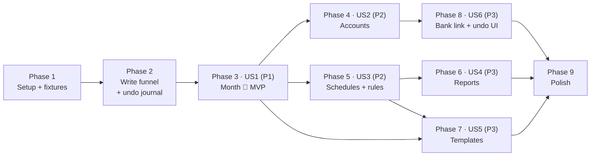

# Tasks: Actual Parity

**Input**: Design documents from `/specs/010-actual-parity/`

**Prerequisites**: plan.md, spec.md, research.md, data-model.md, contracts/

**Tests**: Included. The plan's Testing section and constitution Principle V call for golden-fixture JVM tests against desktop Actual 26.8.1 for every story, sync tests for each new dataset, Compose tests for new screens and confirm gates, Roborazzi light and dark screenshots, and fluidity budgets for the 100-rule save and undo.

**Organization**: Tasks are grouped by user story so each story can be built and tested on its own. Two foundational pieces (the write funnel and the undo journal) come first because every story writes through them.

## Format: `[ID] [P?] [Story] Description`

- **[P]**: Can run in parallel (different files, no dependencies)
- **[Story]**: Which user story this task belongs to (US1–US6)
- Paths are relative to the repo root. `core/…/core/` means `core/budget/src/main/kotlin/app/duenorth/budget/core/`; `core-test/` means `core/budget/src/test/kotlin/app/duenorth/budget/core/`; `app/…/` means `app/src/main/kotlin/app/duenorth/budget/`; `app-test/` means `app/src/test/kotlin/app/duenorth/budget/`



## Phase 1: Setup (Shared Infrastructure)

**Purpose**: Confirm no new module, and land the desktop-Actual fixtures every parity test reads

- [X] T001 Confirm no new module is required in `settings.gradle.kts`; work stays in `:core:budget` and `:app` per `plan.md`
- [X] T002 Add fixture generator `tools/parity-fixtures/generate.mjs` (Node 20+, `@actual-app/api` 26.8.1, pinned in `tools/parity-fixtures/package.json`) that builds each fixture budget, runs the scripted actions from research R1, and writes the budget zip plus expected rows as JSON. Document in `tools/parity-fixtures/README.md` that CI never runs it
- [X] T003 Generate and commit fixtures under `core/budget/src/test/resources/parity/` (`month/`, `accounts/`, `schedules-rules/`, `reports/`, `templates/`, `undo/`), one zip and one `expected.json` per scenario
- [X] T004 [P] Add `core-test/parity/ParityFixture.kt`: opens a fixture zip into a temp budget directory, runs a block, and diffs named tables against `expected.json` with readable row-level failures

---

## Phase 2: Foundational (Blocking Prerequisites)

**Purpose**: Every write goes through the sync funnel, and every person-level action is one journal step. See `contracts/sync-datasets.md` and `contracts/undo.md`

**⚠️ CRITICAL**: No user story work can begin until this phase is complete

### Tests for the foundation

- [X] T005 [P] JVM sync tests in `core-test/SyncDatasetsTest.kt`: each new dataset and column (`rules`, `schedules`, `schedules_next_date`, `notes`, `banks`, bank columns on `accounts`, `categories.goal_def`, `goal` / `long_goal`) round-trips through `LocalActualServer` and applies remotely
- [X] T006 [P] JVM tests for the upgrade backfill in `core-test/ParityBackfillTest.kt`: rules and schedules written with plain SQL before upgrade get pending messages once; a second open emits nothing; files without sync state are untouched
- [X] T007 [P] JVM tests for the journal in `core-test/EditJournalTest.kt`: a step captures old and new values per cell, a new row records null old, undo writes old values as new pending messages, a remote change to a cell turns undo into a conflict with no write, the stack caps at 100 and clears on budget switch

### Implementation for the foundation

- [X] T008 Add `notes` and `banks` tables (`CREATE TABLE IF NOT EXISTS`) and guarded `ALTER TABLE` for `accounts` bank columns, `categories.goal_def`, and `goal` / `long_goal` on `zero_budgets` and `reflect_budgets` in `core/…/core/ActualSchema.kt`
- [X] T009 Widen the column map, numeric set, and `ensureRow` for the new datasets in `core/…/core/SyncSchema.kt` per `contracts/sync-datasets.md`
- [X] T010 Create `core/…/core/EditJournal.kt` (`step(label) { }`, cell capture, `undo()` with conflict check, 100-step cap) and hook capture into `SyncSchema.recordLocal` when a step is open
- [X] T011 Move `RulesBook.insertRule`, `insertPayeeCategoryRule`, `insertPayeeRenameRule` in `core/…/core/RuleEngine.kt` and every `schedules` / `schedules_next_date` write in `core/…/core/Schedules.kt` onto `recordLocal`
- [X] T012 Implement the once-per-budget backfill (guard `sync_state` id `parity-backfill`) in `core/…/core/SyncSchema.kt` and call it from `SyncCoordinator` on open in `core/…/core/SyncCoordinator.kt`
- [X] T013 Feed remote conflicts from undo into spec 004's conflict list in `core/…/core/SyncCoordinator.kt`
- [X] T014 *(Done with phase 3: `ShellUiState.undoLabel` refreshes after every load and edit, and `undo()` lives in `app/…/ShellViewModelMonth.kt` beside the month actions; ktlint's filename rule forbids `+` in file names.)* Own the undo stack in `ShellViewModel` (new `app/…/ShellViewModel+Undo.kt`): clear on budget switch, expose `canUndo` and the newest step's label
- [X] T015 Wrap existing person-level writes (assign, move, hold, carryover, category manage, transaction save/edit/delete/split, schedule post/skip) in `EditJournal.step` in `core/…/core/EnvelopeMonth.kt`, `Register.kt`, `Schedules.kt`

**Checkpoint**: Rules and schedules made on the phone now sync, and every existing edit can be undone in core. Spec 004 sync tests still pass.

---

## Phase 3: User Story 1 - Fill and explain the month (Priority: P1) 🎯 MVP

**Goal**: The to-budget breakdown, copy last month, three-month average, set to zero, transfer back to to-budget, and income auto-hold, all matching desktop Actual.

**Independent Test**: On a fixture month, open the breakdown and check it adds up. Copy last month, then set the month to zero, and compare with desktop Actual. Turn on auto-hold for an income category and confirm next month's to-budget rises by that income.

### Tests for User Story 1

- [X] T016 [P] [US1] Breakdown tests in `core-test/ActualMonthMathTest.kt`: the five parts add up to the header for months with income, carryover, overspend, manual hold, and auto hold
- [X] T017 [P] [US1] Parity tests in `core-test/parity/MonthFillParityTest.kt`: copy (hidden category, hidden group, income skipped on envelope, included on tracking), average with 3 / 2 / 0 earlier months, zero, nothing-to-copy leaves this month alone, each against `parity/month/`
- [X] T018 [P] [US1] Parity tests in `core-test/parity/AutoHoldParityTest.kt`: on writes carryover for m…m+12, off this month only, off entirely, manual hold overrides auto
- [X] T019 [P] [US1] Transfer-to-to-budget tests in `core-test/MonthFillBookTest.kt`: lowers budgeted, raises to-budget, refuses more than available, absent on tracking

### Implementation for User Story 1

- [X] T020 [US1] Add `MonthBreakdown` to `DetailedFigures` from the existing envelope loop in `core/…/core/ActualMonthMath.kt`
- [X] T021 [US1] Create `core/…/core/MonthFill.kt` (`MonthFillBook`: `copyLast`, `average3`, `zero`, `transferToBudget`, `setAutoHold`) writing `zero_budgets` or `reflect_budgets` through the funnel, one journal step per action, with `needsConfirm` per `contracts/month-actions.md`
- [X] T022 [US1] Add entry points in `core/…/core/BudgetLibrary.kt` and `SyncCoordinator.kt`
- [X] T023 [US1] Create `app/…/MonthActionScreens.kt`: breakdown screen (`breakdown-*` tags), fill confirm, transfer-to-to-budget form, auto-hold three-way choice
- [X] T024 [US1] Route handlers and optimistic `OpenMonthStore` updates in new `app/…/ShellViewModel+Month.kt`; roll back on `Rejected` *(file is `ShellViewModelMonth.kt` for ktlint)*
- [X] T025 [US1] Add menu ids `breakdown`, `copy-last`, `average`, `zero`, `undo` on Home and `to-budget`, `auto-hold` on category budget in `app/…/ScreenBar.kt` *(`auto-hold` is three buttons on the income category page rather than a menu id; Home now lists income groups so income categories can be opened)*; make the Home to-budget figure (`to-budget-figure`) open the breakdown in `app/…/EnvelopeScreens.kt`
- [X] T026 [P] [US1] Compose tests in `app-test/MonthActionContentTest.kt`: breakdown rows, confirm gate writes nothing until confirm, tracking hides breakdown / to-budget / auto-hold, undo absent when empty and present after an assign
- [X] T027 [P] [US1] Roborazzi light and dark in `app-test/MonthActionScreenshotTest.kt` for the breakdown and fill confirm

**Checkpoint**: The month is fully Actual. With Phase 2, this is the MVP, including undo of month actions.

---

## Phase 4: User Story 2 - Accounts the person can manage (Priority: P2)

**Goal**: Add, rename, note, reorder, close (with transfer or category), force close, show closed, and reopen.

**Independent Test**: Add an on-budget account with a starting balance, close it into another account, find it under closed accounts, and reopen it. Balances match desktop Actual.

### Tests for User Story 2

- [x] T028 [P] [US2] Parity tests in `core-test/parity/AccountsParityTest.kt` against `parity/accounts/`: create on and off budget with and without balance (Starting Balance transaction, payee, category), rename, note, reorder, close at zero, close on→on, close on→off with category, force close with transfer partners, reopen
- [x] T029 [P] [US2] Validation tests in `core-test/AccountsBookTest.kt`: blank name refused, close with balance and no destination refused, on→off with no category refused, force close needs its own flag

### Implementation for User Story 2

- [x] T030 [US2] Create `core/…/core/Accounts.kt` (`AccountsBook`) per `contracts/accounts.md`, one journal step per action
- [x] T031 [US2] Add `showClosedAccounts` to `PhoneSettings` in `core/…/core/Models.kt` and filter closed accounts in `core/…/core/ShellReader.kt`
- [x] T032 [US2] Entry points in `core/…/core/BudgetLibrary.kt` and `SyncCoordinator.kt`
- [x] T033 [US2] Create `app/…/AccountScreens.kt`: add, edit (name, note), reorder, close with destination and category pickers, force close confirm, closed list with reopen
- [x] T034 [US2] Route handlers in new `app/…/ShellViewModel+Accounts.kt`; close paints within 100 ms of confirm
- [x] T035 [US2] Bar ids `add-account`, `show-closed`, `reorder` on the accounts list and `edit-account`, `close`, `undo` on the register `•••` in `app/…/ScreenBar.kt`
- [x] T036 [P] [US2] Compose tests in `app-test/AccountContentTest.kt` and Roborazzi light and dark in `app-test/AccountScreenshotTest.kt`

**Checkpoint**: US1–US2 work on their own; accounts match desktop.

---

## Phase 5: User Story 3 - Schedules and rules match Actual (Priority: P2)

**Goal**: Schedule editor with Actual's repeats and auto-post; rule editor for six conditions and six actions in three stages with unknown parts kept; learning on/off.

**Independent Test**: Create a monthly auto-post schedule, open on the due date offline, see one transaction. Create a payee → category rule and see it fill. Turn learning off and confirm no learning rule appears.

### Tests for User Story 3

- [x] T037 [P] [US3] Recurrence tests in `core-test/ScheduleRulesBookTest.kt`: once, every N days/weeks/months/years, end after K, end on date, patterns and `skipWeekend` kept on save
- [x] T038 [P] [US3] Auto-post tests in `core-test/ScheduleAutoPostTest.kt`: one transaction when due, none when a match exists, a late open posts the due occurrence without duplicates, finishes within 1 s offline (SC-003)
- [x] T039 [P] [US3] Parity tests in `core-test/parity/RulesParityTest.kt` against `parity/schedules-rules/`: editor round-trip for each field and op, unknown conditions and actions written back byte-for-byte, stages ordered pre → default → post
- [x] T040 [P] [US3] Learning tests in `core-test/parity/LearningParityTest.kt`: on matches desktop's learned rule, off creates none, existing rules still run
- [x] T041 [P] [US3] Benchmark in `core-test/RuleSaveBenchmarkTest.kt`: save with 100 rules within 50 ms of save with none (SC-004)

### Implementation for User Story 3

- [x] T042 [US3] Add the schedule editor model and save (rule + schedule + next date in one step) in `core/…/core/Schedules.kt` per `contracts/schedules-rules.md`
- [x] T043 [US3] Add auto-post to `core/…/core/Schedules.kt` and run it after open and after each sync in `core/…/core/SyncCoordinator.kt`, one journal step per posted occurrence
- [x] T044 [US3] Add the rule editor model with raw passthrough, every op in the contract, and safe failure for unknown ops in `core/…/core/RuleEngine.kt`
- [x] T045 [US3] Cache ranked rules per open budget and clear the cache on any local or remote `rules` write in `core/…/core/RuleEngine.kt`
- [x] T046 [US3] Port `updateCategoryRules` and gate it on `learn-categories` in `core/…/core/RuleEngine.kt`; call it from transaction save in `core/…/core/Register.kt`
- [x] T047 [US3] Add the schedule editor to `app/…/ScheduleScreens.kt` and create `app/…/RuleScreens.kt` (list, editor, stage, "kept from the file" rows)
- [x] T048 [US3] Add the learning switch (`settings-learning`) in `app/…/SettingsScreens.kt`
- [x] T049 [US3] Route handlers in new `app/…/ShellViewModel+Rules.kt`; bar ids `add-schedule` and `rules` on Upcoming in `app/…/ScreenBar.kt`
- [x] T050 [P] [US3] Compose tests in `app-test/RuleContentTest.kt` and Roborazzi light and dark in `app-test/RuleScreenshotTest.kt` for the schedule editor, rule list, and rule editor

**Checkpoint**: A desktop-built file can be maintained on the phone; rules and schedules sync both ways.

---

## Phase 6: User Story 4 - Cash flow, net worth, and spending (Priority: P3)

**Goal**: Three reports for a chosen range, read from the phone copy, matching desktop.

**Independent Test**: For a fixture range, compare cash flow, net worth by month, and spending by category with desktop Actual.

### Tests for User Story 4

- [x] T051 [P] [US4] Parity tests in `core-test/parity/ReportsParityTest.kt` against `parity/reports/`: cash flow excludes on-budget transfers; net worth per month end with off-budget on and off; spending by category, group, and payee, largest first; deleted transactions and split parents excluded; empty range is zeros

### Implementation for User Story 4

- [x] T052 [US4] Create `core/…/core/Reports.kt` (`ReportsReader`) per `contracts/reports.md`; entry points in `core/…/core/BudgetLibrary.kt`
- [x] T053 [US4] Create `app/…/ReportScreens.kt`: `reports` pivot with cash flow, net worth, spending; shared range picker; flat accent bars; content-shaped placeholders while loading
- [x] T054 [US4] Route handlers in new `app/…/ShellViewModel+Reports.kt`, computed on `Dispatchers.IO`; Home menu id `reports` in `app/…/ScreenBar.kt`
- [x] T055 [P] [US4] Compose tests in `app-test/ReportContentTest.kt` (empty range, group-by switch) and Roborazzi light and dark in `app-test/ReportScreenshotTest.kt`

**Checkpoint**: Reports match desktop for the fixture file.

---

## Phase 7: User Story 5 - Budget templates, when enabled (Priority: P3)

**Goal**: Category notes editable always; with both flags on, check, apply (zero only), and overwrite (confirmed), matching desktop.

**Independent Test**: With templates off, a note saves and nothing is budgeted. Turn templates on, check a bad line, fix it, apply, and confirm only zero categories change, matching desktop for each template kind.

### Tests for User Story 5

- [x] T056 [P] [US5] Parser tests in `core-test/TemplateParserTest.kt`: every form in `contracts/templates.md`, priorities, and named errors for bad lines
- [x] T057 [P] [US5] Parity tests in `core-test/parity/TemplatesParityTest.kt` against `parity/templates/`: fixed, up to, by with repeat, schedule (with and without `full`), percentage (with `previous`), average, remainder with weights, goal, priority ordering limited by to-budget, hidden skipped, apply only touches zeros, overwrite, and `goal` / `long_goal` / `goal_def` rows
- [x] T058 [P] [US5] Gate tests in `core-test/TemplateGateTest.kt`: either flag off means no budgeted change from notes; check with an invalid line writes nothing

### Implementation for User Story 5

- [x] T059 [US5] Create `core/…/core/Templates.kt` (`TemplateParser`, `TemplateEngine`) porting the 26.8.1 engine per research R12; one journal step per run
- [x] T060 [US5] Category note read and write through the `notes` dataset in `core/…/core/EnvelopeMonth.kt`; read `flags.goalTemplatesEnabled` in `core/…/core/BudgetLibrary.kt`
- [x] T061 [US5] Create `app/…/TemplateScreens.kt` (check result list, apply, overwrite confirm) and a category note editor on the category budget screen in `app/…/EnvelopeScreens.kt`
- [x] T062 [US5] Add the "budget templates" switch under experimental in `app/…/SettingsScreens.kt`; Home menu id `templates` only when both flags are on in `app/…/ScreenBar.kt`; handlers in new `app/…/ShellViewModel+Templates.kt`
- [x] T063 [P] [US5] Compose tests in `app-test/TemplateContentTest.kt` and Roborazzi light and dark in `app-test/TemplateScreenshotTest.kt`

**Checkpoint**: Templates match desktop, and stay inert when the flags are off.

---

## Phase 8: User Story 6 - Link a bank, and undo a mistake (Priority: P3)

**Goal**: Connect, replace, and remove a bank link through the server's providers; undo from the bar, with conflicts shown.

**Independent Test**: Link an account, remove the link, and confirm fetch is no longer offered. Assign, undo, and confirm to-budget returns offline.

### Tests for User Story 6

- [x] T064 [P] [US6] Bank link tests in `core-test/BankLinkBookTest.kt` with a fake provider on `LocalActualServer`: status, SimpleFIN secret posted to `/secret` and absent from `db.sqlite` and `phone.json`, link writes `banks` and account columns, replace, remove clears them, unreachable server writes nothing
- [x] T065 [P] [US6] Undo end-to-end tests in `core-test/UndoFlowTest.kt`: assign, account edit, and transaction edit undone newest first offline; undo after a conflicting remote change shows a conflict; SC-007 under 100 ms

### Implementation for User Story 6

- [x] T066 [US6] Add provider calls (`gocardless/*`, `simplefin/*`, `pluggyai/*`, `secret`) to `core/…/core/ActualTransport.kt`
- [x] T067 [US6] Add `BankLinkBook` (link, replace, remove) to `core/…/core/BankSync.kt` per `contracts/bank-link.md`, one journal step per change
- [x] T068 [US6] Create `app/…/BankLinkScreens.kt` (provider pick, GoCardless Custom Tab, SimpleFIN token field cleared after send, account match, remove) and handlers in new `app/…/ShellViewModel+BankLink.kt`; register menu id `bank-link`
- [x] T069 [US6] Undo control: menu id `undo` on Home and Register labelled with the newest step, absent when the stack is empty, conflict routed to the conflicts screen, in `app/…/ScreenBar.kt` and `app/…/ShellViewModel+Undo.kt`
- [x] T070 [P] [US6] Compose tests in `app-test/BankLinkContentTest.kt` and `app-test/UndoContentTest.kt`; Roborazzi light and dark in `app-test/BankLinkScreenshotTest.kt`

**Checkpoint**: All six stories work on their own.

---

## Phase 9: Polish & Cross-Cutting Concerns

- [x] T071 [P] Extend the spec 001 fluidity budgets with a 100-rule save and an undo on the panorama
- [x] T072 [P] Offline sweep: run every quickstart scenario that does not need a bank or server with the network off and record the results in `specs/010-actual-parity/quickstart.md`
- ~~T073 Manual side-by-side with desktop Actual 26.8.1 for each quickstart scenario; one real link per provider where accounts exist~~ — **Moved 2026-10-15** to [`docs/backlog.md`](../../docs/backlog.md) as future requirement FR-B001. Spec 010 is complete without it; the automated parity fixtures (generated by @actual-app/api 26.8.1) cover the engine math.
- [x] T074 Propose the constitution amendment for Principle VI (daily-loop gate met; templates and fixed reports allowed) in `.specify/memory/constitution.md`, bumping the version per Governance
- [x] T075 Record before-and-after light and dark screenshots for every visual change with `./gradlew :app:recordRoborazziDebug`, then run `./gradlew :core:budget:test :app:testDebugUnitTest :app:verifyRoborazziDebug`

---

## Dependencies & Execution Order

### Phase Dependencies

- **Setup (Phase 1)**: none
- **Foundational (Phase 2)**: after Setup; blocks every story
- **US1 (Phase 3)**: after Phase 2. The MVP
- **US2 (Phase 4)** and **US3 (Phase 5)**: after US1 (they share the bar and month refresh); can run in parallel with each other
- **US4 (Phase 6)**: after US3 (reports must see auto-posted transactions)
- **US5 (Phase 7)**: after US1 (fills and confirm gate) and US3 (schedule templates read schedules)
- **US6 (Phase 8)**: after US2 (links attach to managed accounts). The undo control can ship earlier with US1 if wanted
- **Polish (Phase 9)**: after the stories you plan to ship

### Within Each Story

- Tests first and failing, then core book, then library entry points, then screens and routes, then UI tests
- Core books only write through the funnel inside a journal step

### Parallel Opportunities

- T004 parallel with T002–T003 once the fixture layout is agreed
- T005–T007 in parallel; T008–T009 before T010–T012
- Within each story, all tasks marked [P] run in parallel
- US2 and US3 in parallel after US1; US4 and US6 in parallel after their dependencies

---

## Parallel Example: Phase 2

```bash
# Tests in parallel:
Task: "SyncDatasetsTest.kt"
Task: "ParityBackfillTest.kt"
Task: "EditJournalTest.kt"

# Then schema → column map → journal → move rules/schedules onto the funnel → backfill
```

## Parallel Example: User Story 3

```bash
# Tests in parallel:
Task: "ScheduleRulesBookTest.kt recurrence"
Task: "ScheduleAutoPostTest.kt"
Task: "RulesParityTest.kt"
Task: "LearningParityTest.kt"
Task: "RuleSaveBenchmarkTest.kt"

# Then schedule editor → auto-post → rule editor → cache → learning → screens
```

---

## Implementation Strategy

### MVP First

1. Phase 1 + Phase 2: fixtures, funnel, journal (this also fixes rules and schedules not syncing today)
2. Phase 3 (US1): the full Actual month
3. **STOP and VALIDATE** US1's independent test against desktop

### Incremental Delivery

1. Setup + Foundational → sync fix + undo in core
2. US1 → month (MVP)
3. US2 → accounts; US3 → schedules and rules (parallel)
4. US4 → reports
5. US5 → templates
6. US6 → bank link + undo control
7. Polish → fluidity, offline sweep, constitution amendment, screenshots

### Suggested MVP scope

Phases 1–3. The funnel fix alone is worth shipping first, because rules and schedules made on the phone do not reach desktop today.

---

## Notes

- [P] tasks = different files, no dependencies on incomplete work
- Never write a synced table outside `SyncSchema.recordLocal`
- Never change `budgetType`; tracking files write `reflect_budgets`
- Bank secrets only go to the server's `/secret`; never into `db.sqlite`, `phone.json`, notes, payees, logs, or export
- Fixtures are the referee for "matches desktop"; do not regenerate them in CI
- Commit after each task or logical group
