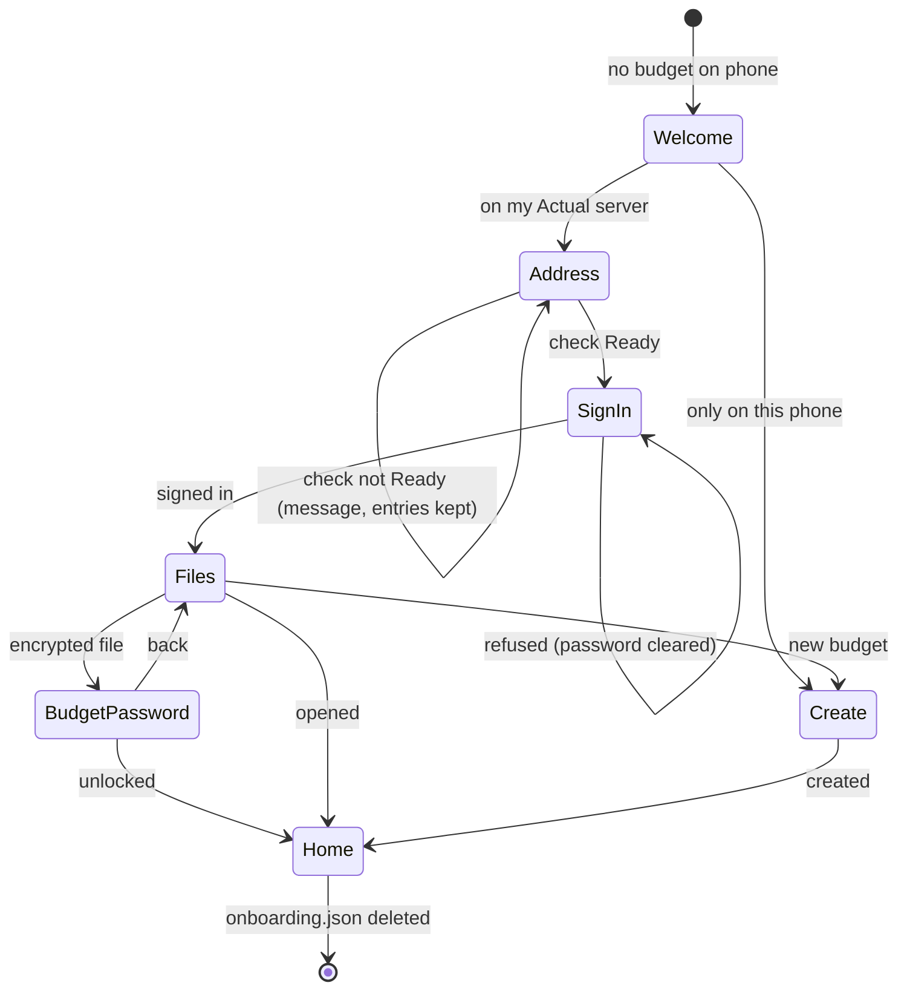

# Data Model: Onboarding and Instance Setup

Phase 1 output for [plan.md](plan.md). Types live in `:core:budget` unless noted.

## OnboardingStep

The page the person is on. Order is the order of the flow.

| Step | Page | Reached from |
|---|---|---|
| `Welcome` | welcome | first launch with no budget |
| `Address` | server address | Welcome → "on my Actual server" |
| `SignIn` | sign in (password or browser) | Address → check is `Ready` |
| `Files` | pick a budget | SignIn → signed in |
| `BudgetPassword` | existing budget password page | Files → encrypted file |
| `Create` | existing new-budget page | Welcome → "only on this phone", or Files → "new budget" |

Back from any step goes to the step it was reached from. Back from `Welcome` closes the app.

## OnboardingProgress (`onboarding.json`)

| Field | Type | Notes |
|---|---|---|
| `step` | `OnboardingStep` | where to resume |
| `path` | `server` \| `phone` \| null | which welcome choice was made |
| `addressText` | String | exactly what the person typed |
| `check` | `ServerCheckSummary?` | last result for `addressText`; dropped when the text changes |
| `instanceLabel` | String? | "name on this phone"; null until edited, then kept |
| `openIdPendingAddress` | String? | set while a browser sign-in is open |
| `chosenFileId` | String? | set on `Files` before `BudgetPassword` |
| `createName` | String | phone-only or server new-budget name |
| `createCurrency` | String | ISO code, default from R9 |

Rules:

- Never holds a password, a token or a budget key.
- Written after each step change and after field edits (debounced 300 ms) on `Dispatchers.IO`.
- Deleted when a budget opens, and deleted on read when the phone already has a budget.

## ServerAddress

| Field | Type | Notes |
|---|---|---|
| `raw` | String | typed text |
| `candidates` | List<String> | normalized URLs to try, in order (R4) |
| `secure` | Boolean | false for a chosen `http://` candidate |
| `host` | String | for the default instance label |

Validation: blank, whitespace inside, or an unparseable host gives no candidates and the page says "enter the server's address".

## ServerCheck (outcome of `ServerProbe.check`)

| Outcome | Carries | Message on the address page |
|---|---|---|
| `Ready` | `address`, `secure`, `methods: Set<SignInMethod>` | (moves to sign in) |
| `Unreachable` | `reason: NoAnswer \| Timeout \| CertificateNotTrusted` | "the server could not be reached" / "the server's certificate is not trusted by this phone" |
| `NotActual` | `httpStatus` | "that address is not an Actual server" |
| `NotSetUp` | – | "this server is not set up yet. finish setting it up in Actual, then try again" |
| `Unsupported` | `methods: List<String>` | "this server only allows {method} sign-in, which the phone cannot use" |

`SignInMethod` is `Password` or `Browser` (Actual's `openid`). Other server methods, such as `header`, only appear in `Unsupported`. An Actual server too old to list its sign-ins is treated as password-only, which is what those servers had, rather than refused: the phone cannot read a server's version without signing in.

`ServerCheckSummary` is the persisted shape: outcome name, address, secure flag, methods. It holds no response bodies.

## SavedInstance (existing, spec 009)

| Field | Change |
|---|---|
| `label` | now set from the sign-in page's "name on this phone"; settings shows `label ?: host` |

No other change. Finishing the server path upserts the instance and makes it active through the same `SyncCoordinator.connect` / `completeOpenId` calls settings uses.

## RemoteFile row (display only)

| Shown | From |
|---|---|
| name | `RemoteFile.name` |
| caption "encrypted · asks for its password" | `encryptKeyId != null` |
| caption short id | first 6 of `fileId`, only when another row has the same name |
| caption "on this phone" | a local budget already has this `groupId` as its cloud file |

## State transitions

