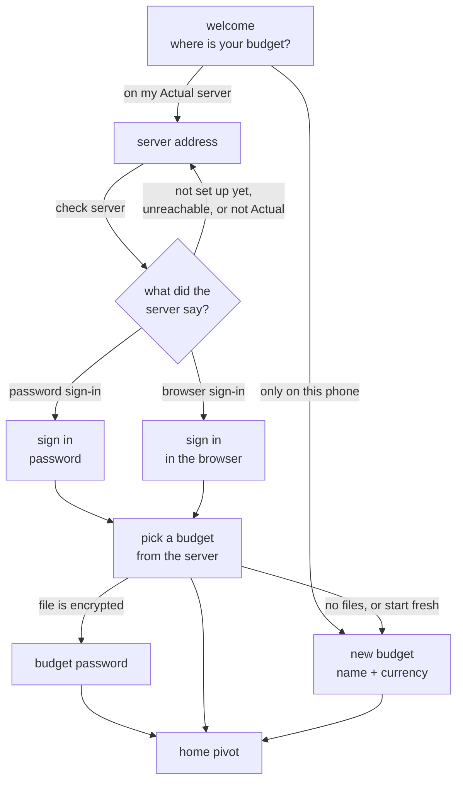

# Feature Specification: Onboarding and Instance Setup

**Feature Branch**: `011-onboarding-instance`

**Created**: 2026-10-14

**Status**: Draft

**Input**: User description: "Better onboarding workflow, asking for instance information. Use the metro guidelines for onboarding if there are any."

## Context

Today a fresh install opens straight onto "new budget": a name field and a
long currency list. Nothing says the app can work with an Actual server,
and a person who already runs one has to create a throwaway budget, find
settings, and add the server there (spec 009). This spec replaces that
first screen with a short first-run flow that asks where the budget lives
first, then asks for the instance details the phone needs.

"Instance" keeps the meaning from spec 009: the Actual server this phone
syncs with, not a budget file.

### The flow

### Metro guidance this spec follows

Windows Phone never shipped one "onboarding" guideline. The pieces that do
exist, together with Metro 2 in the constitution, set the rules here:

- **Pages, not pop-ups.** Phone Metro has no flyouts. Each step is its own
  full page with the small uppercase app title over an oversized lowercase
  page title (Principle II).
- **Primary actions in the bottom application bar.** "next", "sign in" and
  "done" are round outlined app bar buttons, where the thumb is, not
  buttons at the top of the page. The ellipsis expands their labels.
- **The phone's back gesture is the back button.** No on-screen back
  control. Back from any step returns to the step before with its entries
  kept.
- **Ask for sign-in only when it is needed.** Microsoft's guidance lets an
  app sign in at launch only when it cannot work without it. Due North
  works without a server (Principle III), so the server path is offered,
  never forced, and "only on this phone" is always one tap away.
- **Show who you are signed in as, and offer sign-out.** The finish of the
  server path names the instance, and settings keeps the sign-out from
  spec 009.
- **Content over chrome, motion as language.** Turnstile between steps,
  tilt on press, no spinners that cover the page (Principles I and II).

## User Scenarios & Testing *(mandatory)*

### User Story 1 - Connect to my Actual server on first launch (Priority: P1)

A person who already runs Actual installs the app. The first page asks
where their budget lives. They choose their Actual server, type its
address, and the phone checks it. The phone then asks only for the sign-in
that server uses. Once signed in, they see the budgets on that server, pick
one, and land on the home pivot with that budget open and syncing.

**Why this priority**: People who already use Actual are the main audience
(Principle III). Today they cannot reach their server without first making
a budget they do not want.

**Independent Test**: On a fresh install with a test server that has one
budget, go from first launch to that budget's home pivot without opening
settings and without creating a local budget.

**Acceptance Scenarios**:

1. **Given** a fresh install, **When** the app opens, **Then** the first page asks where the budget lives and offers "on my Actual server" and "only on this phone", and it does not show the new-budget form.
2. **Given** the person chose the server path, **When** they enter an address and press next, **Then** the phone checks the server and shows that it is checking without covering the page, and the next button cannot be pressed twice.
3. **Given** the server signs in with a password, **When** the check finishes, **Then** the next page asks for the password only.
4. **Given** the server signs in through the browser, **When** the check finishes, **Then** the next page offers browser sign-in and the person returns to the flow signed in.
5. **Given** sign-in succeeds, **When** the server has budgets, **Then** the person sees them by name and can open one.
6. **Given** the chosen budget is encrypted, **When** they open it, **Then** they are asked for the budget password before any amount shows.
7. **Given** they open a budget, **When** the home pivot appears, **Then** that budget is open, the server is the active instance in settings, and the instance carries a name the person can recognize.

---

### User Story 2 - Start a budget on this phone only (Priority: P1)

A person without a server chooses "only on this phone". They name the
budget and pick a currency, and land on the home pivot. Nothing about
servers is asked. They can connect a server later from settings.

**Why this priority**: The app must stay useful with no server (Principle
III). This path must be no slower than today's single screen.

**Independent Test**: On a fresh install with the network off, go from
first launch to an empty budget's home pivot.

**Acceptance Scenarios**:

1. **Given** the welcome page, **When** the person chooses "only on this phone", **Then** they see the new-budget page with a name and a currency.
2. **Given** the new-budget page, **When** it opens, **Then** the currency already selected is the one for the phone's region, and the person can change it.
3. **Given** a blank name, **When** they press done, **Then** no budget is created and the page says a name is needed.
4. **Given** a name, **When** they press done, **Then** the home pivot opens on the new budget.
5. **Given** the network is off, **When** they follow this path, **Then** every step works.

---

### User Story 3 - Clear help when the instance is wrong (Priority: P2)

The person types an address that is wrong, unreachable, not an Actual
server, or a server that has not been set up yet. The phone says which of
those it is in plain words, keeps what they typed, and lets them fix it,
try again, or start on the phone instead.

**Why this priority**: Most first-run failures are a mistyped address or a
server that is not reachable from the phone. A vague failure ends the
onboarding.

**Independent Test**: Enter, in turn, an address with no server, a web
page that is not Actual, and a server with no password set. Each gives a
different message and leaves the address in place.

**Acceptance Scenarios**:

1. **Given** the address has no scheme, **When** the person presses next, **Then** the phone tries it as a secure address first.
2. **Given** nothing answers at the address, **When** the check ends, **Then** the page says the server could not be reached, keeps the address, and offers try again and "only on this phone".
3. **Given** something answers but it is not an Actual server, **When** the check ends, **Then** the page says so.
4. **Given** the server has never been set up, **When** the check ends, **Then** the page says to finish setting up the server in Actual first, and the phone does not try to set it up.
5. **Given** the password is refused, **When** sign-in ends, **Then** the page says the password was not accepted, clears the password, and keeps the address.
6. **Given** the server only allows a sign-in the phone cannot do, **When** the check ends, **Then** the page says which sign-in it needs and that the phone cannot use it.

---

### User Story 4 - Pick up where I left off (Priority: P2)

The person leaves the app halfway through, because they went to look up
the server address or the phone killed the app. When they return they are
on the same step, with what they typed still there, except passwords.

**Why this priority**: Looking up a server address usually means leaving
the app. Starting over each time is the most common way first-run flows
are abandoned.

**Independent Test**: Enter an address, leave the app, force-stop it, and
reopen it. The address page shows the same address.

**Acceptance Scenarios**:

1. **Given** the person is on any step, **When** they leave the app and come back, **Then** they are on that step with their entries.
2. **Given** they were on a password page, **When** they come back, **Then** the password field is empty.
3. **Given** they press back on any step, **When** the previous step shows, **Then** its entries are kept.
4. **Given** they press back on the welcome page, **When** the app closes, **Then** nothing has been created and the next launch shows the welcome page again.

---

### User Story 5 - Server with no budget yet (Priority: P3)

The person signs in to a server that has no budgets, or none they want.
They create a budget on the phone and it is sent to that server, so the
two are linked from the start.

**Why this priority**: New Actual users often stand up a server first and
budget second. This saves a trip to settings to send the budget.

**Independent Test**: Sign in to an empty test server, create a budget in
the flow, and see that budget listed on the server.

**Acceptance Scenarios**:

1. **Given** sign-in succeeds and the server has no budgets, **When** the list shows, **Then** it says so and offers "new budget".
2. **Given** the server has budgets, **When** the person does not want any of them, **Then** "new budget" is also offered.
3. **Given** they create a budget this way, **When** the home pivot opens, **Then** the budget is on the phone, the server is active, and the budget is sent to the server in the background.
4. **Given** sending fails, **When** the home pivot opens, **Then** the budget is still editable and the sync status says it has not been sent yet.

---

### Edge Cases

- A person who already has a budget on the phone updates the app. They
  never see the welcome page.
- The address has a trailing slash, extra spaces, or a sub-path where the
  server is hosted. The phone keeps the sub-path and drops the rest.
- The address is a plain (not secure) address. The phone allows it and
  says on the address page that the connection is not encrypted.
- The server's certificate is not trusted by the phone. The page says so
  and does not connect.
- The network drops between the check and sign-in. Sign-in reports that
  the server could not be reached, and the address is kept.
- The server is a version the phone does not support. The page names the
  problem and suggests "only on this phone".
- The server takes a long time to answer. The person can press back to
  stop waiting at any time, and the page never freezes.
- The person backs out of browser sign-in without finishing. They return
  to the sign-in page, not signed in.
- Two budgets on the server have the same name. Both show, told apart by
  when each was last changed.
- The person cancels the budget password page. They return to the server's
  budget list, and the encrypted budget is not opened.
- The phone has no budgets but has a saved instance (for example after a
  budget was removed). The welcome page shows, and the server path starts
  with that instance already filled in.
- Debug builds keep the sample budgets. They are reachable from the
  welcome page only in debug builds with developer mode on.

## Requirements *(mandatory)*

### Functional Requirements

- **FR-001**: When the phone has no budget, the app MUST open on a welcome
  page that asks where the budget lives, with exactly two paths: an Actual
  server, or this phone only. A phone that has a budget MUST NOT show it.
- **FR-002**: The server path MUST ask for the instance address first and
  MUST check the server before asking for any sign-in.
- **FR-003**: The check MUST tell apart: not reachable, not an Actual
  server, not set up yet, an unsupported version, and ready. Each MUST have
  its own plain message.
- **FR-004**: After a successful check, the phone MUST ask only for the
  sign-in that server uses: a password, or a browser sign-in. A sign-in the
  phone cannot do MUST be named, not hidden.
- **FR-005**: The instance MUST get a display name, filled in from the
  server's address, that the person can change on the sign-in page.
  Settings (spec 009) MUST show that name.
- **FR-006**: After sign-in, the person MUST see the budgets on that server
  and MUST be able to open one or create a new budget instead.
- **FR-007**: Opening an encrypted budget MUST ask for its password before
  any amount shows, using the existing budget password page.
- **FR-008**: The phone-only path MUST ask for a name and a currency, MUST
  preselect the currency for the phone's region, and MUST NOT ask anything
  about servers.
- **FR-009**: Every step MUST be its own full page, with its primary action
  in the bottom application bar and back handled by the phone's back
  gesture, following Metro 2 (Principle II).
- **FR-010**: Each step MUST show feedback within 100 ms of a tap. Server
  checks and sign-in MUST NOT block the page, MUST NOT show a full-screen
  spinner, and MUST be cancellable with back (Principle I).
- **FR-011**: Entries MUST survive back, leaving the app, and the app being
  stopped, except passwords, which MUST never be kept by the flow.
- **FR-012**: A failure MUST keep the person's entries, say what failed,
  and offer to try again or to continue on this phone only.
- **FR-013**: The flow MUST NOT set up a server, create a server password,
  or change server settings. Server administration stays out of scope
  (Principle VI).
- **FR-014**: Finishing either path MUST land on the home pivot with the
  chosen or new budget open. Finishing the server path MUST leave that
  server as the active instance, with the same result as adding it in
  settings.
- **FR-015**: A budget created on the server path MUST be sent to that
  server in the background, and MUST stay editable if sending fails.
- **FR-016**: Every onboarding page MUST have screenshot checks in light
  and dark (Principle V).

### Key Entities

- **Instance**: The Actual server from spec 009. This flow adds a display
  name the person can recognize.
- **Server check result**: What the phone learned about an address:
  reachable or not, Actual or not, set up or not, supported or not, and
  which sign-ins it accepts.
- **Onboarding progress**: The step the person is on and what they typed,
  minus passwords. It is cleared once a budget is open.

## Success Criteria *(mandatory)*

### Measurable Outcomes

- **SC-001**: A person with a working server and its password goes from
  first launch to their budget's home pivot in under 2 minutes, in no more
  than five pages, without opening settings.
- **SC-002**: A person on the phone-only path goes from first launch to an
  empty budget in under 30 seconds, with the network off.
- **SC-003**: Each of the five check outcomes in FR-003 shows a different
  message, and in testers' hands at least 9 of 10 can say what to do next
  from the message alone.
- **SC-004**: Every tap in the flow shows feedback in under 100 ms, and
  page transitions hold the phone's frame rate.
- **SC-005**: After leaving the app and having it stopped, the person
  returns to the same step with their non-password entries in 100% of
  tests.
- **SC-006**: After updating, no person who already has a budget on the
  phone sees the welcome page.

## Assumptions

- Spec 009 owns saved instances, switching, and sign-out. This spec only
  adds a first-run route into the same result, plus an instance display
  name.
- Spec 004 owns how a server file is downloaded, opened, synced, and sent.
  This flow calls those same steps.
- The sign-ins in scope are the two the phone already supports: password
  and browser sign-in. Other server sign-ins are named as unsupported.
- No account creation, no server setup, no tour of features, and no
  marketing pages. The welcome page is a choice, not a carousel.
- The welcome page is not drawn in `docs/design/metro-mockups.svg`. It
  follows the Due North Tasks reference and Principle II until a mockup
  frame is added during planning.
- Currency preselection uses the phone's region. When the region has no
  matching currency, the default stays USD, as today.
- QR codes, discovering servers on the local network, and importing a file
  from another app during onboarding are out of scope.
