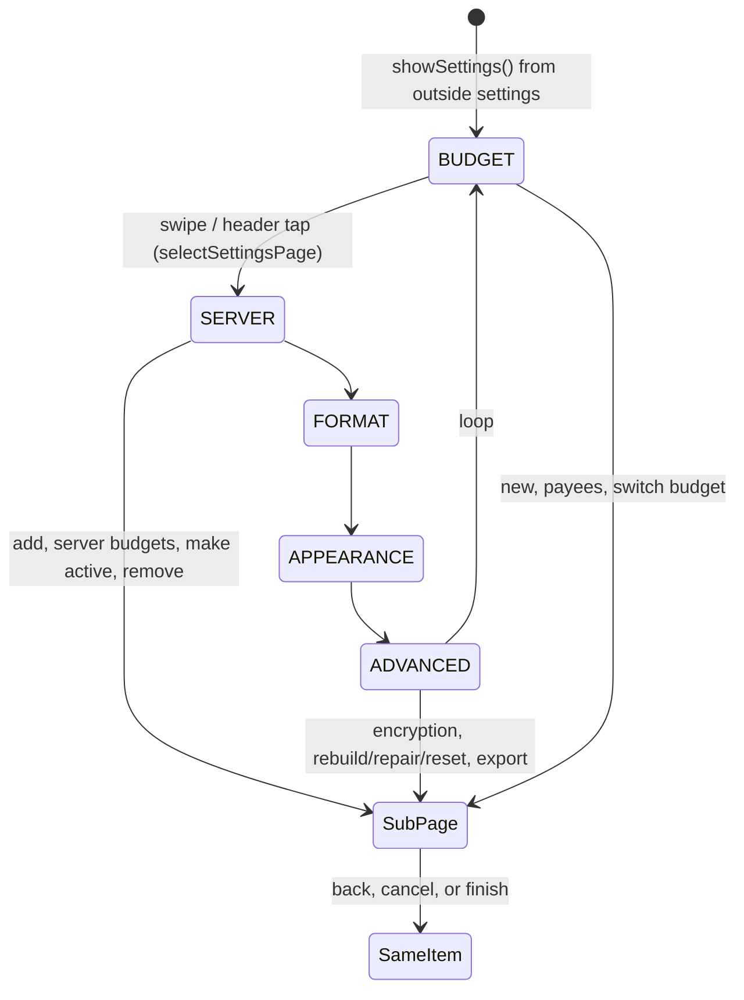

# Data Model: Settings Pivot

No budget-file or server data changes. The model is view state plus one field on stored onboarding progress.

## SettingsPage (new, `:app`)

```kotlin
enum class SettingsPage(val header: String, val needsBudget: Boolean) {
    BUDGET("budget", false),
    SERVER("server", false),
    FORMAT("format", true),
    APPEARANCE("appearance", false),
    ADVANCED("advanced", true),
}
```

- **Visible items**: `SettingsPage.entries.filter { !it.needsBudget || budgetOpen }`, in declaration order (FR-002).
- **Validation**: if the stored page is not visible (the budget closed), it falls back to `BUDGET` (spec edge case).

## ShellUiState additions

| Field | Type | Default | Meaning |
|---|---|---|---|
| `settingsPage` | `SettingsPage` | `BUDGET` | Item showing, or to show on return to settings. |
| `settingsScroll` | `Map<SettingsPage, Int>` | empty | Scroll offset per item, restored on return (R3). |

State transitions:



- `showSettings()` (app bar on home) resets `settingsPage = BUDGET` and clears `settingsScroll` (FR-015, spec assumption).
- Returning from a settings sub-page sets `route = Settings` and leaves `settingsPage` as it was.

## New routes

| Route | Opened from | Returns to |
|---|---|---|
| `ShellRoute.EncryptionPassword(mode: EncryptionMode)` | advanced item | advanced |
| `ShellRoute.ConfirmRemoveInstance(instanceId: String)` | server item | server |

```kotlin
enum class EncryptionMode { SET, CHANGE, REMOVE }
```

Existing routes reused from settings, each now returning to `Settings` and its item: `Create` (budget), `Payees` (budget), `ConfirmSwitch` (budget), `ConfirmInstanceSwitch` (server), `Server` (server), `OnboardingAddress` / `OnboardingSignIn` / `OnboardingFiles` with settings origin (server), confirm-advanced overlay (advanced).

Removed: `ShellRoute.Appearance` (R10).

## OnboardingProgress (`:core:budget`, stored in `onboarding.json`)

| Field | Type | Default | Change |
|---|---|---|---|
| `origin` | `OnboardingOrigin` | `FIRST_RUN` | New. `SETTINGS` when started from the server item. |

```kotlin
@Serializable enum class OnboardingOrigin { FIRST_RUN, SETTINGS }
```

- Files written before this change have no `origin`; `ignoreUnknownKeys` plus the default read them as `FIRST_RUN`.
- A `SETTINGS` progress is kept by `restoreOnboarding()` even when the phone has budgets; a `FIRST_RUN` progress is still dropped then.
- Passwords are never stored, as in spec 011.
- Progress is cleared when the settings-origin flow finishes or is backed out of from the address page.

## Saved instance (unchanged, spec 009 / 011)

The server item reads `PhoneSettings.instances`, `activeInstance()`, `instanceReachable`, and `signedIn` as today. Display name is `label ?: address`.
