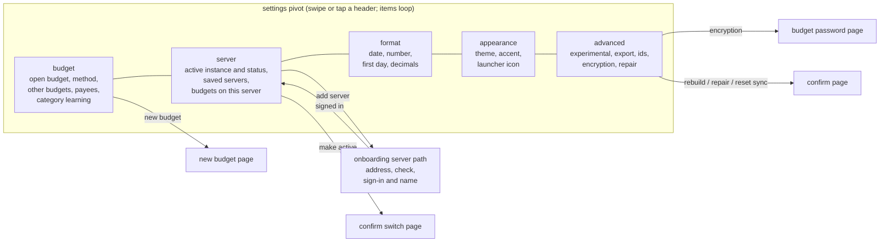

# Feature Specification: Settings Pivot

**Feature Branch**: `012-settings-pivot`

**Created**: 2026-10-14

**Status**: Draft

**Input**: User description: "fix the settings view so it is more organized. If needed, break it into separate views. Use one of the multi-view patterns (like panorama, but it doesn't have to be that one) if it does break things into separate views." Follow-up: "Use the onboarding workflow for guidance on selecting a server."

## Context

Settings (spec 009) is one long page. Thirteen groups sit in a single
scroll: instance, budgets, appearance, launcher icon, payees, formatting,
method, rules, experimental, ids, export, encryption, and advanced. The
server group alone fills the first screen with a saved-server list, an
address field, a password field, and three buttons, so a person who only
wants to change the accent scrolls past the sign-in form every time. Every
edit form (sign in, new budget, encryption password) is open inline at
all times, and the destructive actions sit at the bottom of the same
scroll as the theme.

This spec splits settings into a **pivot**: one settings screen whose
areas are full-width pivot items under a row of headers, the same pattern
as the home screen. The constitution keeps a panorama for a hub that
previews several areas at once; settings is not that, and Metro 2 says
secondary screens that need tabs use a pivot (Principle II). Adding a
server stops being an inline form and reuses the onboarding server path
from spec 011.

### The new shape

Pivot items marked "open budget only" in the requirements below (format
and advanced) are left out of the header row when no budget is open.

## User Scenarios & Testing *(mandatory)*

### User Story 1 - Find a setting without scrolling past everything (Priority: P1)

A person opens settings to change one thing, for example the accent. They
see a row of pivot headers naming each area, tap "appearance" (or swipe
to it), and the accent choices are on screen. Nothing about servers or
encryption is in the way.

**Why this priority**: This is the problem the person reported. Every
other story depends on settings being split into areas.

**Independent Test**: With a budget open, open settings and reach the
accent choices, the date format, and the export action, each in no more
than two gestures from the moment settings opens, without scrolling past
any other area.

**Acceptance Scenarios**:

1. **Given** a budget is open, **When** the person opens settings, **Then** they see the settings title over a pivot header row with budget, server, format, appearance, and advanced, and the budget item is showing.
2. **Given** settings is open, **When** the person swipes left or right, **Then** the next or previous item slides in and the header row follows, looping from the last item to the first.
3. **Given** settings is open, **When** the person taps a dimmed header, **Then** that item opens.
4. **Given** any item is showing, **When** the person reads it, **Then** it holds only that area's settings, grouped under small headings.
5. **Given** no budget is open, **When** the person opens settings, **Then** the header row shows only budget, server, and appearance.

---

### User Story 2 - Add and choose a server the onboarding way (Priority: P1)

On the server item the person sees the active instance by name, with its
address and whether the phone is signed in and has reached it. Saved
servers are listed under it. To add a server they press "add" in the
application bar and go through the same pages as the onboarding server
path: address, the phone checks the server, then only the sign-in that
server uses, with the name the instance goes by on this phone. When they finish they return to the
server item with the new server shown. Making another saved server active
still goes through the confirm page that names the server left and the
server opening.

**Why this priority**: The server form is what crowds settings today, and
the person asked for server selection to follow onboarding. Two different
ways to add a server would also mean two sets of error messages to keep
in step.

**Independent Test**: From settings, add a test server that uses password
sign-in. The pages, checks, and error messages match onboarding, the flow
ends on the server item, and the new server is listed by its name.

**Acceptance Scenarios**:

1. **Given** no server is saved, **When** the person opens the server item, **Then** it says the phone is not connected to a server and offers "add" in the application bar, with no address or password field on the item itself.
2. **Given** the person presses add, **When** they enter an address and press next, **Then** the phone checks the server exactly as onboarding does, and tells apart not reachable, not an Actual server, not set up yet, an unsupported version, and ready.
3. **Given** the check says ready, **When** the next page shows, **Then** it asks only for the sign-in that server uses (password or browser) and lets them name the instance.
4. **Given** sign-in succeeds, **When** the flow ends, **Then** the person is back on the server item, the new server is listed by its name, and it is active.
5. **Given** sign-in succeeds and no budget is open, **When** the flow ends, **Then** the person is shown the budgets on that server, as in onboarding, and can open one or go back to settings without opening one.
6. **Given** two servers are saved and A is active, **When** the person taps B and chooses make active, **Then** the confirm page names A as left and B as opening, and no local budget is merged into a file on B.
7. **Given** the person presses back during the add flow, **When** they reach the server item again, **Then** nothing was saved and the active server is unchanged.
8. **Given** a server is active, **When** the person chooses sign out from the application bar menu, **Then** the session ends and the budgets on the phone stay.

---

### User Story 3 - Edit forms open only when asked (Priority: P2)

Forms that were always open on the long page become their own pages,
opened by an action: new budget, set or change or remove the encryption
password. The settings items show the current value and the action, not
empty fields.

**Why this priority**: Empty fields for rare tasks are most of the clutter
after the server form. Metro uses full pages, not inline forms or
pop-ups, for a task (spec 011, "pages, not pop-ups").

**Independent Test**: Open every settings item and confirm no text field
is visible until an action that needs one is pressed.

**Acceptance Scenarios**:

1. **Given** the budget item is showing, **When** the person presses "new" in the application bar, **Then** a new-budget page opens with a name and a currency, the same as the onboarding phone-only page.
2. **Given** the new-budget page, **When** the person saves a name, **Then** that budget is created and open, and they return to the budget item.
3. **Given** the advanced item is showing and the file has no encryption password, **When** the person looks at the encryption heading, **Then** it says the budget is not encrypted and offers "set password", with no field open.
4. **Given** the person chooses set, change, or remove password, **When** the page opens, **Then** it asks only for the passwords that action needs, and back leaves the file unchanged.
5. **Given** any settings item, **When** it is first shown, **Then** no text field is on it.

---

### User Story 4 - Keep risky actions apart from everyday ones (Priority: P2)

Rebuild totals, repair splits, reset sync, the ids, export, and
encryption live on the advanced item, at the end of the header row. They
keep their confirm page. Everyday choices (theme, accent, format) are on
items that have no destructive action.

**Why this priority**: Today a person changing the theme is one scroll
from reset sync. Grouping by risk lowers the chance of a wrong tap.

**Independent Test**: Check that rebuild, repair, and reset sync are only
on the advanced item, and that each still asks for confirmation.

**Acceptance Scenarios**:

1. **Given** the advanced item, **When** the person presses rebuild, repair, or reset sync, **Then** the existing confirm page opens before anything changes.
2. **Given** the budget, format, or appearance item, **When** the person looks at it, **Then** it has no action that changes or removes budget data without a confirm page.

---

### User Story 5 - Come back to the same place (Priority: P3)

When the person opens a page from settings (add server, new budget,
payees, encryption, a confirm page) and comes back, they return to the
item they left, scrolled where they were.

**Why this priority**: Returning to the first item after every sub-page
would make the split feel slower than the old long page.

**Independent Test**: From the advanced item, open export and come back;
the advanced item is showing.

**Acceptance Scenarios**:

1. **Given** the person is on the server item, **When** they finish or back out of the add-server flow, **Then** the server item is showing.
2. **Given** the person leaves settings for the home pivot, **When** they open settings again later, **Then** it opens on the budget item.

---

### Edge Cases

- No budget is open (for example after the last budget is removed). The
  header row has only budget, server, and appearance. The budget item
  lists budgets on the phone, if any, and offers new.
- The open budget is closed while settings is showing format or
  advanced. Settings moves to the budget item, and those headers leave the
  row.
- The active server cannot be reached. The server item says it has not
  been reached, the open budget stays editable, and choosing another
  saved server still works offline (spec 009).
- The add-server flow is left halfway (the person leaves the app). Coming
  back resumes the step with entries kept, except passwords, as in
  onboarding.
- The person adds an address that is already saved. The flow signs in to
  that saved server instead of adding a second copy.
- The person removes the active server. The server item asks for
  confirmation, says the budgets on the phone stay, and then shows no
  active server.
- The system "remove animations" setting is on. Pivot changes are
  immediate, with no slide.
- A large font size makes an item longer than the screen. The item
  scrolls on its own; the header row stays put.

## Requirements *(mandatory)*

### Functional Requirements

- **FR-001**: Settings MUST be a single pivot screen following Metro 2:
  the small uppercase app title, a row of extra-large pivot headers with
  the selected one leading, full-width items that loop and snap, and a
  header tap that opens its item (Principle II).
- **FR-002**: The pivot MUST have these items in this order: budget,
  server, format, appearance, advanced. Format and advanced MUST appear
  only when a budget is open.
- **FR-003**: The budget item MUST show the open budget's name and its
  budgeting method (read-only), the other budgets on the phone with a way
  to switch to one, a "new" action, a way to open payees, and the
  category learning switch.
- **FR-004**: The server item MUST show the active instance's name,
  address, and status (signed in, signed out, or not reached), and list
  every saved server with the active one marked.
- **FR-005**: Adding a server from settings MUST use the onboarding server
  path from spec 011 (address, server check, then the sign-in that server
  uses together with the instance's name on this phone), with the same checks and messages. After sign-in it
  MUST show the pick-a-budget page for that server; back from any step returns to the server item.
- **FR-005a**: Picking a server budget (from onboarding, from settings, or from the server page) MUST make it
  the only budget on the phone. When the phone already holds other budgets, a confirmation MUST name each one
  that gets cleared before anything is removed; "keep" returns to the list with nothing changed, and a failed
  download clears nothing. Server copies are never touched.
- **FR-006**: The server item MUST NOT contain address or password fields.
- **FR-007**: Making a saved server active MUST use the existing confirm
  page that names the server left and the server opening, then, when signed in to it, the pick-a-budget page
  for that server (FR-005a). Removing a
  saved server MUST ask for confirmation first.
- **FR-008**: Sign out MUST be offered on the server item when a server
  is active, and MUST keep the budgets on the phone (spec 009).
- **FR-009**: When a server is active and signed in, the server item MUST
  offer the budgets on that server. With no budget open this is the
  onboarding pick-a-budget page. With a budget open it is the existing
  server page, which also offers sending the open budget, sync now, and
  conflicts (see research R5).
- **FR-010**: The format item MUST hold the date format, number format,
  first day of the week, and hide decimals settings for the open budget,
  each saved to the budget file as today (spec 009).
- **FR-011**: The appearance item MUST hold the theme, accent, and
  launcher icon choices, which stay on the phone.
- **FR-012**: The advanced item MUST hold, in this order: experimental
  features (including goal templates), export, the budget and sync ids,
  encryption, and rebuild totals, repair splits, and reset sync.
- **FR-013**: New budget, and setting, changing, or removing the
  encryption password, MUST each open their own full page. No settings
  item MUST show a text field before the person starts one of these
  actions.
- **FR-014**: Each pivot item MUST have a bottom application bar with
  that item's actions as round outlined buttons and an ellipsis that
  expands labels and a menu: "new" on budget, "add" on server (sign out in
  the menu), "export" on advanced. Items with no action MUST still show
  the bar with the ellipsis (Principle II).
- **FR-015**: Returning from any page opened from settings MUST show the
  pivot item it was opened from. Opening settings from outside MUST show
  the budget item.
- **FR-016**: Every setting available on the settings page today MUST
  still be reachable, and each change MUST take effect the same way it
  does today. Nothing moves out of settings and nothing is dropped.
- **FR-017**: Pivot swipes and header taps MUST give feedback within
  100 ms and hold the phone's full frame rate. Server checks and
  sign-in MUST NOT block the pivot or show a full-screen spinner
  (Principle I).
- **FR-018**: Each settings pivot item, and each new page this spec adds,
  MUST have screenshot checks in light and dark, and the change MUST ship
  with before-and-after screenshots (Principle V).

### Key Entities

- **Settings item**: one area of settings shown as a pivot item: its
  header label, whether it needs an open budget, and the application bar
  actions it offers.
- **Saved instance**: an Actual server the phone knows (spec 009): its
  name, address, sign-in method, and whether it is active and signed in.

## Success Criteria *(mandatory)*

### Measurable Outcomes

- **SC-001**: From opening settings, every setting is reachable in at most
  two gestures (a swipe or header tap, then the control), not counting
  scrolling within one item.
- **SC-002**: With a budget open, at default font size on a 6-inch phone,
  the budget, server, format, and appearance items each fit in one screen
  height, and advanced in at most two.
- **SC-003**: No settings item shows an empty text field when first
  opened (today the page shows six).
- **SC-004**: Adding a server from settings and from onboarding produce
  the same pages and the same message for each of the five check results.
- **SC-005**: Every setting listed in spec 009 and the later additions
  (launcher icon, category learning, goal templates) is present after the
  change; an audit finds none missing.
- **SC-006**: Swiping between settings items shows no dropped frames a
  person can see on a Pixel 6a class phone.

## Assumptions

- A pivot, not a panorama, is the multi-view pattern. The constitution
  reserves panorama for a hub that previews several areas at once, and
  says secondary screens that need tabs use a pivot.
- Five items is the right split. Format gets its own item because its
  four choices are per-budget and would make the budget item scroll;
  experimental features go to advanced because they are opt-in and rare.
- The onboarding server pages from spec 011 (merged in PR #41) are
  reused as-is: the address page, the sign-in page with its "name on this
  phone" field, and the pick-a-budget page.
- Settings opens on the budget item each time; remembering the last item
  across visits is not needed.
- The confirm pages for switching servers and for advanced actions keep
  their current wording.
- Payees stays its own screen, reached from the budget item; this spec
  does not change it.
- Tablet layouts are out of scope (Principle VI).
